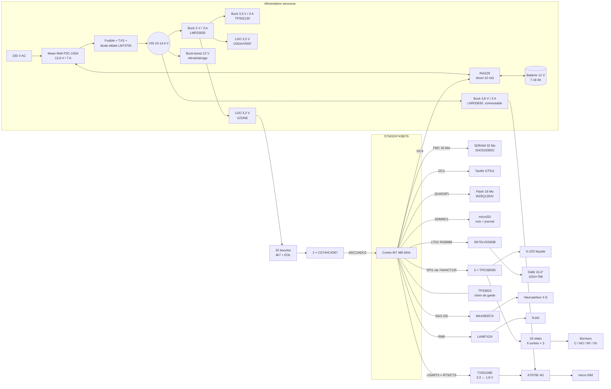

# 1. Architecture matérielle

## 1.1 Cahier des charges

| Fonction | Réalisation retenue |
|---|---|
| 32 entrées filaires (contact ouvert / fermé) | Boucles analogiques supervisées (NF, NO, simple ou double résistance de fin de ligne), 2 multiplexeurs 16 voies → ADC 16 bits du STM32 |
| 6 sorties relais, mode configurable par logiciel | Par sortie : 1 relais de puissance + 2 relais de sélection → **contact sec**, **+12 V** ou **+5 V** sur le commun, protégés par PTC |
| Annonce vocale | Fichiers WAV sur microSD → SAI (I2S) → ampli classe D MAX98357A 3 W → haut-parleur |
| Ethernet | PHY LAN8742A (RMII) + RJ45 à transformateur intégré, pile lwIP, API HTTP/JSON, heure SNTP |
| Interface téléphonique 4G | Module SIMCom A7670E (LTE Cat-1 + repli 2G, Europe) + support micro-SIM : SMS, appels vocaux avec messages, commandes DTMF |
| Alimentation secourue | Bloc certifié Mean Well PSC-100A (230 V → 13,8 V, chargeur batterie intégré) + batterie plomb 12 V 7 à 18 Ah ; surveillance INA226 |
| Écran tactile 1024×768 | Dalle 10,4" XGA LVDS + dalle tactile capacitive (contrôleur GT911/GT928) ; LTDC → SN75LVDS83B ; LVGL v9 |
| MCU STM32 | **STM32H743BIT6** (Cortex-M7 480 MHz, 2 Mo Flash, 1 Mo RAM, LQFP208) + SDRAM 32 Mo + Flash QSPI 16 Mo |

## 1.2 Synoptique

## 1.3 Choix techniques et justification

**Un seul microcontrôleur.** Le STM32H743 est suffisamment puissant pour gérer simultanément l'affichage XGA (LTDC + accélérateur DMA2D), la pile TCP/IP et la logique d'alarme. La sûreté de fonctionnement est assurée par :
- une tâche d'alarme à la plus haute priorité applicative, indépendante de l'IHM ;
- un chien de garde interne (IWDG) **et** un chien de garde externe (TPS3823) rafraîchis uniquement si les tâches critiques sont vivantes ;
- une chaîne de relais **relue** à chaque écriture (sortie série du dernier TPIC6B595 rebouclée sur MISO) ;
- des relais au repos (sorties coupées, mode contact sec) tant que le logiciel n'a pas démarré (/G des TPIC6B595 tiré au niveau haut).

**Boucles analogiques plutôt que simples entrées tout-ou-rien.** Une mesure analogique permet la double résistance de fin de ligne (DEOL) : on distingue *repos*, *alarme*, *coupure* et *court-circuit* sur deux fils, ce qui détecte le sabotage du câble. Chaque zone reste configurable en NF/NO simple pour des contacts sans résistance.

**Mesure ratiométrique.** Les résistances de tirage sont alimentées par un régulateur dédié (VZONE) dont la tension est mesurée à chaque cycle ; la classification utilise le rapport V_boucle / VZONE et ne dépend donc ni de la précision du régulateur ni de celle de VREF+.

**Sorties à 3 relais.** Le mode (sec / 12 V / 5 V) est sélectionné par deux petits relais en amont du relais de puissance. Les relais de sélection sont inverseurs « break-before-make » : le 12 V et le 5 V ne peuvent jamais se rejoindre, et le logiciel impose une séquence de commutation (voir `docs/05-logiciel.md`). Un contact sec reste véritablement isolé des alimentations internes.

**Bloc d'alimentation certifié.** La partie 230 V est confiée à un module du commerce (PSC-100A : chargeur de batterie, protection contre la décharge profonde, contacts « AC OK » et « BAT LOW »). La carte ne manipule donc que de la très basse tension (≤ 15 V), ce qui simplifie fortement la conception et la sécurité électrique.

**Module 4G Cat-1 avec repli 2G.** Le réseau 2G est en cours d'arrêt en France ; le Cat-1 est le meilleur compromis coût/consommation pour SMS + voix (VoLTE). Le module est alimenté par un régulateur commandable pour pouvoir le redémarrer « à froid » en cas de blocage.

## 1.4 Bilan de consommation (estimation)

| Poste | Veille écran éteint | Écran allumé | Alarme (sirènes) |
|---|---|---|---|
| Logique 3,3 V (MCU, SDRAM, PHY, divers) | 1,5 W | 1,5 W | 1,5 W |
| Dalle LCD logique + rétroéclairage | 0 W | 1 W + 4,5 W | 5,5 W |
| Module 4G (veille / appel) | 0,1 W | 0,1 W | 2 W |
| Relais de sélection (3 sorties en 12 V) | 0,5 W | 0,5 W | 0,5 W |
| Relais de puissance actifs | 0 W | 0 W | 1,5 W |
| **Centrale seule** | **≈ 2,1 W (160 mA)** | **≈ 7,6 W** | **≈ 11 W** |
| + Détecteurs sur AUX 12 V (exemple 20 × 15 mA) | 3,9 W (300 mA) | | |
| + Sirènes sur sorties 12 V (exemple 2 × 400 mA) | | | 10,4 W |

**Dimensionnement de la batterie** (écran mis en veille après 2 minutes) :
`C = (I_veille × T_autonomie + I_alarme × T_sirène) / 0,8`
Exemple : (0,46 A × 36 h + 1,7 A × 0,25 h) / 0,8 ≈ **21 Ah** → batterie 12 V 18 Ah pour ~ 30 h, ou 7 Ah pour ~ 12 h.

## 1.5 Organisation de la carte

Carte 4 couches recommandée (signal / masse / alimentations / signal), format 300 × 210 mm (voir hardware/kicad/alarme32/alarme32.kicad_pcb), fixée au fond d'un coffret métallique avec autoprotection à l'ouverture. Zones :
1. **Bord inférieur** : borniers à vis (Phoenix MKDS 1,5, pas 5,08 mm) (32 zones + 32 communs 0 V regroupés, AUX 12 V, 6 sorties × 4 bornes, haut-parleur, alimentation, batterie).
2. **Centre** : MCU, SDRAM au plus près (pistes FMC appairées en longueur, ± 5 mm), QSPI.
3. **Bord supérieur** : connecteur LVDS de la dalle, FPC tactile, RJ45, microSD, USB-C (maintenance).
4. **Coin isolé** : module 4G avec plan de masse continu, pistes d'antenne 50 Ω coplanaires, connecteurs U.FL vers antennes externes au coffret.
5. Rangée de relais séparée de la logique par une garde de masse ; les retours de courant des bobines rejoignent le point de masse étoile à l'entrée d'alimentation.
