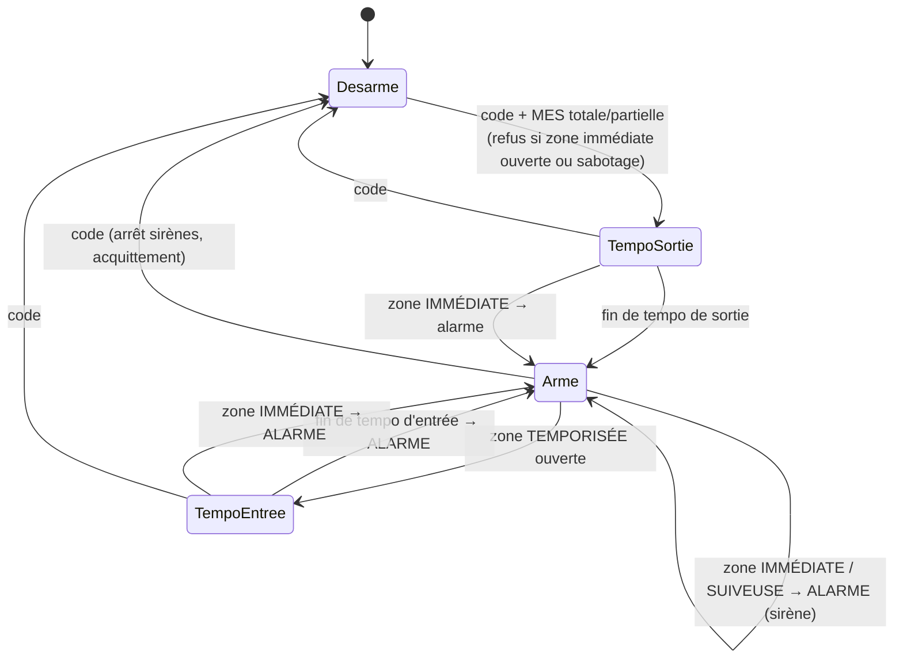

# 5. Conception du logiciel

## 5.1 Principes

- **Noyau portable** (`firmware/core/`) : toute la logique d'alarme est écrite en C11 pur, sans dépendance à la HAL STM32 ni à FreeRTOS. Il est compilé et **testé sur PC** (tests unitaires + simulateur console). Le même code est lié tel quel dans le firmware.
- **Plateforme** (`firmware/platform/stm32h7/`) : pilotes de la carte, tâches FreeRTOS, réseau (lwIP), IHM (LVGL v9), stockage (QSPI, FatFS).
- **Événements** : le noyau ne fait aucune entrée/sortie ; il émet des événements que la plateforme journalise, annonce vocalement, transmet par SMS/appel et affiche.
- **Sûreté** : la tâche d'alarme est la plus prioritaire, ne dépend pas de l'IHM ni des communications, et conditionne le rafraîchissement des chiens de garde.

```mermaid
flowchart TB
    subgraph PLATEFORME["Plateforme STM32H7 (FreeRTOS)"]
        T1[alarm_task 10 ms] --> ZB[bsp_zones<br/>ADC + MUX]
        T1 --> RB[bsp_relays<br/>SPI TPIC6B595]
        T2[power_task 1 s] --> PB[bsp_power<br/>INA226 + ADC]
        T3[modem_task] --> MD[modem_a76xx<br/>AT, SMS, appels, DTMF]
        T4[net_task] --> NA[net_api<br/>HTTP/JSON, SNTP]
        T5[ui_task] --> UI[ui_main<br/>LVGL]
        T6[audio_task] --> AU[bsp_audio<br/>WAV → SAI]
        T7[supervisor 500 ms] --> WD[IWDG + TPS3823]
    end
    subgraph NOYAU["Noyau portable (core/)"]
        APP[alarm_app] --> ZI[zone_input<br/>classification, anti-rebond]
        APP --> EN[alarm_engine<br/>machine d'états]
        APP --> OU[outputs<br/>fonctions + séquence de mode]
        APP --> PM[power_monitor]
        APP --> LOG[event_log]
        APP --> NO[notifier<br/>SMS + appels en cascade]
        APP --> VO[voice<br/>composition des annonces]
        APP --> RC[remote_cmd<br/>SMS / réseau / DTMF]
        APP --> US[users<br/>SHA-256 salé, anti force brute]
    end
    T1 & T2 & T3 & T4 & T5 -->|core_lock| APP
```



## 5.2 Modules du noyau

| Fichier | Rôle |
|---|---|
| `alarm_types.h` | Types communs : états de boucle, câblages, types de zones, modes et fonctions de sorties, défauts |
| `alarm_config.[ch]` | Structure de configuration persistante (CRC32), valeurs d'usine |
| `zone_input.[ch]` | Classification ‰ → court-circuit / repos / alarme / coupure ; interprétation selon le câblage ; anti-rebond par zone |
| `alarm_engine.[ch]` | Machine d'états : MES totale/partielle, temporisations, alarmes 24h/24, inhibitions, zones bavardes, défauts |
| `outputs.[ch]` | Calcul de l'état des 6 sorties (sirène, flash, report…), impulsions, inversion, **séquence sûre de changement de mode** |
| `power_monitor.[ch]` | Défauts secteur (temporisé), batterie basse (hystérésis), batterie absente, fusibles, référence VZONE |
| `event_log.[ch]` | Journal circulaire de 512 événements, formatage horodaté |
| `notifier.[ch]` | File de notifications : SMS à tous les abonnés, appels en cascade jusqu'à acquittement (3 tours) |
| `voice.[ch]` | Textes des messages, composition « Alarme intrusion. Zone 12 <nom> » |
| `remote_cmd.[ch]` | Analyse et exécution des commandes texte (SMS, API) |
| `users.[ch]`, `sha256.[ch]` | Codes 4 à 8 chiffres, hachage SHA-256 salé, comparaison en temps constant, verrouillage 3 min après 5 erreurs |
| `alarm_app.[ch]` | Assemblage et point d'entrée unique de la plateforme |

## 5.3 Machine d'états d'armement



**Types de zones**

| Type | Désarmé | Tempo de sortie | Armé | Tempo d'entrée |
|---|---|---|---|---|
| Immédiate | carillon éventuel | alarme | alarme | alarme |
| Temporisée | carillon éventuel | ignorée | → tempo d'entrée | ignorée |
| Suiveuse | carillon éventuel | ignorée | alarme | ignorée |
| 24h/24 | alarme | alarme | alarme | alarme |
| Incendie | alarme + sirène modulée | idem | idem | idem |
| Panique | alarme (silencieuse si option) | idem | idem | idem |
| Technique | alarme sans sirène | idem | idem | idem |
| Autoprotection | sabotage | sabotage + sirène | sabotage + sirène | sabotage + sirène |

Règles complémentaires :
- **Sabotage** d'une boucle DEOL (coupure ou court-circuit) : toujours signalé ; sirène si le système est armé (ou si l'option `tamper_when_disarmed_siren` est active).
- **Zone bavarde** : au-delà de `swinger_limit` (3) déclenchements dans une même période d'armement, la zone est inhibée automatiquement.
- **Inhibition** : manuelle (code maître, système à l'arrêt) ou automatique lors d'une MES forcée ; levée à la mise hors service.
- **Sirène** : durée `siren_duration_s` (180 s par défaut), puis réarmement automatique ; le flash reste actif jusqu'à la MHS.
- **Alarme panique** : jamais annoncée sur le haut-parleur local (discrétion).

## 5.4 Sorties : fonctions et changement de mode

Fonctions disponibles : sirène, sirène incendie (modulée 1 s / 1 s), flash, report « en service », report défaut, recopie de zones, télécommande (écran / SMS / réseau), buzzer de temporisation, report panique, report technique. Chaque sortie peut être inversée et/ou impulsionnelle (durée en secondes).

Changement de mode électrique (sec ↔ 12 V ↔ 5 V), réalisé par `outputs.c`, 50 ms entre chaque étape :

```
1. K_MAIN  ouvert         (la charge n'est plus alimentée)
2. K_SRC   au repos       (le commun est déconnecté de toute source)
3. K_VSEL  positionné     (12 V ou 5 V, sans charge)
4. K_SRC   positionné     (sec : repos ; alimenté : travail)
5. K_MAIN  autorisé selon la logique de la sortie
```
Le test unitaire `test_mode_switch` vérifie qu'à aucun moment K_VSEL ne bascule pendant que K_SRC est au travail.

## 5.5 Tâches FreeRTOS

| Tâche | Priorité | Période | Pile | Rôle |
|---|---|---|---|---|
| supervisor | 7 | 500 ms | 1 Ko | Rafraîchit IWDG + TPS3823 si alarm et power sont vivantes |
| alarm | 6 | 10 ms | 4 Ko | Acquisition des 32 boucles, autoprotection, moteur, relais (+ relecture) |
| power | 4 | 1 s | 4 Ko | INA226, rails, liaison Ethernet, écriture du journal sur microSD |
| audio | 4 | évén. | 4 Ko | Lecture des fragments WAV, DMA double tampon |
| modem | 3 | évén. | 8 Ko | Réseau mobile, SMS entrants/sortants, appels, DTMF, redémarrage du module |
| net | 3 | évén. | 8 Ko | Serveur HTTP/JSON, SNTP |
| ui | 2 | 5-20 ms | 16 Ko | LVGL + tactile ; seule tâche autorisée à appeler LVGL |

L'accès au noyau est protégé par un mutex récursif (`core_lock` / `core_unlock`). Les traitements longs (SD, modem, réseau) sont faits **hors** verrou.

## 5.6 Commandes à distance

**Par SMS** (uniquement depuis un numéro de la liste de contacts autorisé « télécommande ») :

| SMS envoyé | Effet | Réponse |
|---|---|---|
| `1234 ETAT` | — | `Ma maison: Desarme. Zones ouvertes: 3,7` |
| `1234 MES` (ou `ARMER`, `TOTAL`) | Mise en service totale | état |
| `1234 MESP` (ou `PARTIEL`) | Mise en service partielle | état |
| `1234 MHS` (ou `DESARMER`, `ARRET`) | Arrêt + coupure sirènes | état |
| `1234 SORTIE 6 ON` / `OFF` | Sortie en fonction « télécommande » | état |

Un SMS d'un numéro inconnu est supprimé **sans réponse**.

**Appel d'alarme** (cascade sur les contacts abonnés) : message « Ici votre centrale d'alarme. Alarme intrusion. Zone 3 … », puis menu : **1** = acquitter (arrête la cascade), **2** = réécouter, **9 + code + #** = mise hors service.

**Appel entrant** depuis un numéro autorisé : annonce de l'état, puis **code + 1 + #** = MES, **code + 9 + #** = MHS.

**API HTTP/JSON** (réseau local) :

```
GET  /api/etat              → {"etat":2,"mode":0,"alarmes":0,"defauts":0,"tempo_s":0,"secteur":true,...}
GET  /api/zones             → [{"n":1,"nom":"Porte d'entree","type":2,"etat":"repos","mesure":524,"inhibee":false},...]
GET  /api/sorties           → [{"n":1,"nom":"Sirene interieure","mode":"12V","fonction":1,"active":false},...]
GET  /api/journal?n=50      → ["2026-11-24 14:05:12 ALARME INTRUSION - Z3 Salon", ...]
POST /api/commande          corps : "1234 MES"  → {"ok":true,"reponse":"..."}
```
Exemple : `curl -X POST --data "1234 ETAT" http://192.168.1.50/api/commande`

> 🔒 L'API n'est pas chiffrée dans cette version : ne pas l'exposer sur Internet sans VPN (ou ajouter mbedTLS/HTTPS).

## 5.7 Annonces vocales

Les fragments sont des fichiers WAV (16 kHz, 16 bits, mono) sur la microSD :

```
/VOIX/M001.WAV … M024.WAV   messages (table voice_texts[] dans core/voice.c)
/VOIX/N001.WAV … N032.WAV   nombres « un » … « trente-deux »
/VOIX/Z001.WAV …            noms de zones enregistrés (optionnel)
```

Le script `tools/gen_voix.sh` les génère automatiquement par synthèse vocale française (Piper ou espeak-ng), et produit aussi les versions AMR à copier dans le module 4G pour les appels.

## 5.8 Configuration et stockage

- Configuration (`alarm_config_t`, ~ 3 Ko) en Flash QSPI, **deux emplacements** avec numéro de génération et CRC32 : une coupure pendant l'enregistrement ne peut pas corrompre la configuration en service.
- Codes d'usine : installateur `0000`, maître `1234` — **à changer** à la mise en service. Les sels sont tirés par le générateur aléatoire matériel (RNG) au premier démarrage.
- Journal : 512 événements en RAM + fichier `JOURNAL.CSV` sur microSD (écriture différée par la tâche power).

## 5.9 Construction

**Noyau sur PC** (Linux, macOS, Windows/MSYS2) :

```bash
cd firmware
cmake -S . -B build
cmake --build build
./build/test_core        # 105 vérifications
./build/alarm_sim        # simulateur interactif
```

**Firmware STM32** (STM32CubeIDE 1.16+ ou CMake + arm-none-eabi-gcc) :

1. Créer un projet STM32CubeMX pour **STM32H743BITx**, configurer les périphériques selon `03-brochage-stm32.md` :
   FMC SDRAM (bank 1, CAS 2, 100 MHz), LTDC (RGB888, 65 MHz, timings feuillet 4), DMA2D, ADC1/2/3 (16 bits, suréchantillonnage ×16), SPI1 (maître, mode 0, 1 MHz), I2C1 et I2C4 (400 kHz), USART3 (115200, RTS/CTS, DMA RX), USART1, SAI1 bloc A (I2S maître, 16 kHz, 16 bits stéréo, DMA circulaire), SDMMC1 (4 bits), QUADSPI, ETH (RMII) + LwIP (DHCP, SNTP, netconn), FATFS (SD), FREERTOS (CMSIS v2, tick 1000 Hz), RTC (LSE), RNG, IWDG1 (≈ 4 s), TIM1 CH1 PWM 20 kHz, MPU (SDRAM cacheable, tampons DMA non cacheables en section `.dma_buffer` en RAM D2).
2. Ajouter au projet : `firmware/core/*.c`, `firmware/platform/stm32h7/*.c`, LVGL v9 (`lv_conf.h` : `LV_COLOR_DEPTH 16`, `LV_USE_DRAW_DMA2D 1`).
3. Dans `main.c` (section USER CODE), appeler `app_start();` juste avant `osKernelStart()` / `vTaskStartScheduler()`.
4. Dans `lwipopts.h` : `#define SNTP_SET_SYSTEM_TIME(s) app_sntp_set_time(s)`.

> ⚠️ La couche plateforme est écrite contre les API HAL STM32H7, FreeRTOS, lwIP, FatFS et LVGL v9, mais **n'a pas encore été compilée ni essayée sur la carte** (elle dépend du projet CubeMX). Le noyau, lui, est compilé et testé.
